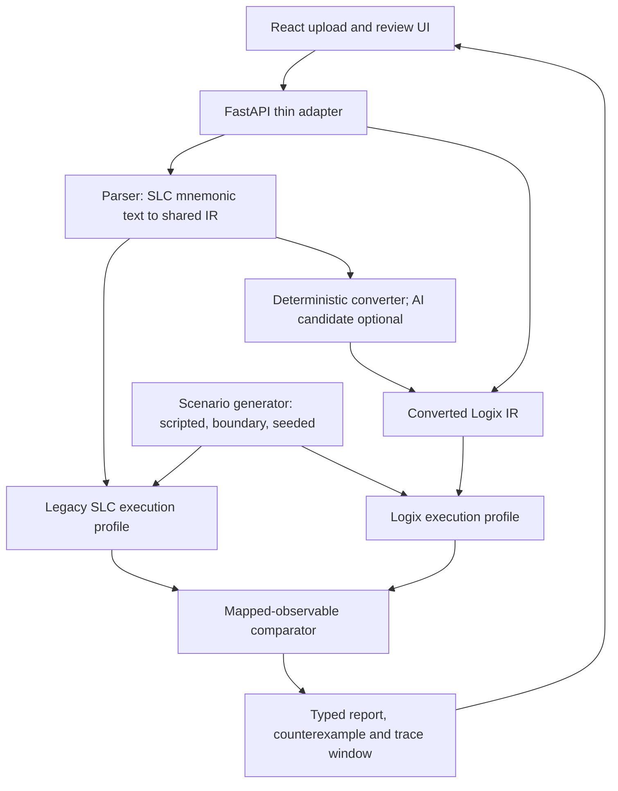

# LadderProof

**Behavioral regression testing for legacy-to-modern PLC program migrations**  
**Hatchathon x VOXO 2026 · Legacy Tech track · Prototype for November 9, 2026**  
**Project status:** Implementation specification / hackathon MVP. Features and benchmark results below are *planned*, not claims that working code or industrial validation already exists.

> **The converter proposes. LadderProof checks.**

## In one minute

An industrial **programmable logic controller (PLC)** reads inputs such as buttons and sensors, executes a control program, and updates outputs such as motors, lights, and valves. When a factory replaces an older PLC with a newer model, engineers may need to convert the control program. The translated program can be syntactically acceptable while making a different decision at a particular input or time.

**LadderProof takes the original SLC 500 ladder-logic program and a converted Logix candidate, replays the *same input scenarios* against both in a constrained software simulator, and reports the *first observable behavioral difference* with enough input history to reproduce it.** If a converted program has not been supplied, an MVP rule-based translator can propose one. This is **not** a full industrial emulator, automatic repair tool, hardware inventory manager, or safety certification system.

### Example

Imagine a conveyor is supposed to start after a 500 ms delay. The original program has a timer preset of **50 ticks × 10 ms/tick = 500 ms**. A deliberately faulty conversion interprets the preset as **50 ms**. When both programs see the same `Start = ON` input, the new program activates the motor much earlier.

LadderProof's goal is not to say merely "line 3 changed." It reports which output changed, the simulated scan on which the outputs first disagree, and the input sequence that triggers that result. **The exact timer-divergence scan is dependent on the validated first-scan timer convention; do not treat a sample scan number as a hardware fact.** Rockwell documents automatic timer-value scaling in its converter; our wrong-preset example is a *seeded test defect*, not an allegation that Rockwell's tool normally produces it.

## What problem are we solving?

### The migration problem

1. A plant has a working control program for an older PLC.
2. An engineer or conversion tool rewrites the program for a modern controller.
3. The rewritten program may run but respond differently to a button, interlock, branch condition, or timer boundary.
4. Manually checking all relevant input sequences and recording the first failure takes engineering effort.
5. LadderProof aims to automate a **limited, reproducible part** of that comparison.

### How this differs from our original PLC idea

| Earlier PLC inventory / modernization-planning concept | LadderProof |
|---|---|
| Which controllers are installed? | Does a migrated program behave differently? |
| What firmware, licenses, spare parts, or upgrade deadlines are missing? | Which tested input scenario first produces a different output? |
| What replacement work should be scheduled? | What input history can an engineer replay to investigate a conversion error? |

These are distinct products aimed at different stages of modernization. **LadderProof does not inventory hardware, firmware, licensing, missing files, replacement parts, or migration schedules.**

### Value proposition and limits of market evidence

The proposed value is **less repetitive migration-verification work and earlier discovery of supported conversion defects**. PLC migration services, code converters, emulators, and test frameworks already exist. We have **not established** an unserved market, a unique industry-wide feature, commercial willingness to pay, or a dollar value for losses specifically attributable to PLC conversion mistakes. Broad industrial downtime figures are **not** LadderProof's addressable market.

The hackathon will report measured outcomes on controlled, labeled examples: seeded bugs caught/missed, false alarms, unsupported cases, runtime, and manual-versus-assisted testing effort. External controls-engineer interviews are desirable but **not a requirement to present the prototype**.

## User-facing workflow

1. **Upload** legacy SLC 500 mnemonic-text logic and, optionally, a converted Logix candidate. Full native `.RSS` and `.L5X` projects are **not** supported by the MVP.
2. **Parse** only the declared instruction subset into a shared intermediate representation (IR). Fail explicitly on unsupported constructs; never silently omit them.
3. **Convert (optional).** If no target program is supplied, the deterministic rules produce a candidate and document which rules were used.
4. **Confirm tag mappings.** The UI shows correspondences such as `I:1/0 → Start`, `O:2/0 → Motor`, and `T4:0/DN → Timer0.DN`. Ambiguous mappings require review.
5. **Choose a test configuration.** Default: 10 ms per simulated scan, seeded scripted / boundary / random input sequences, supported predefined execution profiles.
6. **Simulate.** The engine executes the legacy and target logic **separately**, with their respective documented profiles, using **identical physical-input events**. It records observable values after each full scan.
7. **Compare and report.** The comparator identifies the earliest divergence and supplies a replayable input prefix plus a short trace window. The UI displays a side-by-side code view, mapping confirmation, divergence timeline, and summary.

### What "behavioral simulation" means

A PLC typically repeats a cycle of reading inputs, executing control logic, and updating outputs. LadderProof **models that cycle in Python**—it doesn't connect to a plant or animate an entire factory. For example: on each simulated scan, apply a button event, execute supported ladder rungs in order, update modeled timer state, record motor/valve commands, and move to the next scan.

The old and new programs receive **the same input events, not necessarily identical internal instruction semantics**. One profile might express a timer accumulation in 10 ms ticks, the other in milliseconds. We compare **mapped observable outputs and timer status bits**, not raw internal timer counts that have different units.

### Report meanings (only these three)

| Status | Exact interpretation |
|---|---|
| `different` | A mapped output or timer-status bit differed in at least one fully supported tested scenario. |
| `no_difference_observed` | No difference was observed **under the stated profiles, scenarios, initial state, and limits**. This is not proof of equivalence or safety. |
| `needs_review` | An instruction, tag mapping, starting state, or required semantic rule is unsupported/ambiguous/unvalidated. Never treat this as a pass. |

## MVP scope and non-goals

**P0 / must ship:** Allen-Bradley **SLC 500 mnemonic-text subset**; `XIC`, `XIO`, `OTE`, series contacts, one-level OR branches (`BST`/`NXB`/`BND`), and `TON` with an explicit timebase. Deterministic conversion, one shared simulation engine with two named execution profiles, mapped-observable comparator, CLI, JSON report, and local UI.

**Stretch 1 (only after P0 passes):** an LLM such as Claude proposes a *candidate converted program*. The deterministic simulator checks it; AI has no authority to declare a pass.

**Stretch 2 (only after Stretch 1 and a stable core):** a restricted `GRT` comparison referencing a timer `.ACC`, motivated by documented review warnings for references to timer PRE/ACC values. This is **not** a general math-instruction implementation.

**Not in scope:** PLC-5 simulation, full RSLogix/Studio 5000 project import/export, arbitrary timers/counters, motion, PID, messaging, file instructions, communications protocols, actual PLC hardware, hardware compatibility, downtime forecasts, automatic patching, automatic modernization recommendations, or safety-rated validation.

If the timer model cannot be independently validated before the demo, **reduce to bit/branch testing** and report timer behavior as `needs_review`. Do not expand scope just because a fourth developer joins.

## Architecture



**One engine, two profiles:** `slc_subset_v1` and `logix_subset_v1`. Execution behavior is deterministic and documented in `docs/semantics.md`; the timer units are profile-specific. The simulator must not modify its rules to make a conversion appear correct.

**Shared integration rule:** the engine, translator, verifier, API, and UI exchange the **exact IR, mapping, input-event, trace, and report contracts** in [`CONTRACT.md`](CONTRACT.md). No teammate is allowed to invent a competing schema. The existing [`CLAUDE.md`](CLAUDE.md) governs coding-agent behavior; conflicts must be resolved by team agreement before code changes.

## Technology stack

| Layer | MVP choice | Role |
|---|---|---|
| Simulator, scenario generation, translation, comparison | Python 3.14 + dataclasses | Pure, deterministic engineering core |
| Parser | Lark | Limited mnemonic grammar with diagnostics |
| API | FastAPI + Pydantic v2 + Uvicorn | Thin adapters and typed validation |
| Automated tests | pytest | Golden traces, mutation tests, API and end-to-end checks |
| Web UI | React + TypeScript + Vite | Upload, mapping, code comparison, timeline, report |
| UI libraries | Tailwind CSS, Monaco, Recharts | Styling, diff view, timeline |
| Persistence | Local JSON files | Project and report artifacts for offline demo |
| Optional AI | Claude API behind a timeout/fallback | Candidate conversion only, never the verdict |

No C++ requirement, production database, hosted service, cloud dependency, or physical PLC equipment in the P0 build. The real demo **must run without internet or AI**.

## Team ownership

| Teammate | Owns | Handoff |
|---|---|---|
| **Arnav** | `backend/app/semantics.py`, `scenarios.py`, hand-computed golden traces, `docs/semantics.md` | `run(program_ir, input_events, profile, dt_ms) -> Trace` plus deterministic scenario inputs |
| **Tami** | `grammar.lark`, `ir.py`, `parser.py`, `translator.py`, `comparator.py`, `report.py`, `cli.py`, benchmark runner | `parse()`, `convert()`, `verify()` plus tag-map suggestions and report JSON |
| **Sadia** | Demo fixtures and practice/held-out defects, answer key, benchmark execution, user interview, pitch and backup video | Independent evaluation data and truthful measured results |
| **Adaora** | `api.py`, frontend integration, map-confirmation screen, divergence view, offline packaging and UI tests | Working upload → convert/verify → displayed report |

If Adaora's API/UI integration isn't working by Friday evening, Sadia owns the **minimal** fixture-driven UI and thin API; no one rewrites the core engine to accommodate the frontend.

## Delivery milestones

| Date | Gate | If gate fails |
|---|---|---|
| **Thursday, Nov 5** | Schemas locked; one bit/branch fixture parses and executes to a hand-computed golden trace; CLI detects an inverted contact | Keep UI fixture-driven and cut unsupported syntax |
| **Friday, Nov 6** | Timer golden cases independently validated; demonstrable bit/branch and timer counterexamples; `needs_review` for unsupported input | Cut timers if invalid; retain tested bit/branch LadderProof |
| **Saturday, Nov 7, 6 pm** | Freeze features; run hidden held-out mutations once; generate actual benchmark table | Drop AI, Stretch 2, and visual polish before compromising trace correctness |
| **Sunday, Nov 8** | Offline end-to-end demo, README/limitations, backup video, rehearsed ~150-second expo pitch | Demonstrate CLI + saved report if UI is unstable |
| **Monday, Nov 9** | Hatchathon expo | State limitations and actual tested scope |

The 150-second expo length is a planning target; the team must confirm the published event rules. The pitch should focus on a documented migration-review risk, a seeded reproducible bug, measured detection results, and a restrained commercial hypothesis.

## Evaluation: what we will actually measure

- **Engine fidelity:** hand-calculated positive, negative, and boundary golden traces for each supported instruction/profile; written **independently of our simulator**.
- **Detection:** count bugs caught and missed by category on hidden seeded test cases; separately report the denominator.
- **False alarms:** count `different` results on correctly converted negative controls.
- **Coverage:** number of scenarios, scans, seed, execution profile, and cases marked `needs_review`.
- **Runtime:** wall-clock execution time on the demo hardware; do not quote a target as an achieved result.
- **Manual effort:** time a teammate performing the *same* small test task manually versus the complete LadderProof workflow, including setup and review. Label it an internal measurement—not industrial ROI.

Practice mutations are available to developers. Sadia keeps hidden cases and their answer key **outside the shared repository** until after code freeze; developers do not tune on that result.

## Getting started (intended commands; not yet confirmed against built code)

Once the agreed repository structure and dependency files have been implemented, the expected local workflow is:

```bash
# From the repository root; after Python 3.14 and Node.js are installed
python -m pip install -r backend/requirements.txt
python -m pytest backend/tests
python -m uvicorn backend.app.api:app --reload
```

In a separate terminal:

```bash
cd frontend
npm install
npm run dev
```

These are **target developer commands**, not a claim that those files already exist or that installation has been tested. The module owner must update this section if the approved package layout changes.

### Planned repository structure

```text
README.md
CONTRACT.md
CLAUDE.md
backend/
  requirements.txt
  app/
    grammar.lark  ir.py  parser.py  semantics.py  scenarios.py
    translator.py comparator.py report.py api.py cli.py
  tests/
    fixtures/   golden/
    test_semantics.py test_translator.py test_e2e.py
frontend/
  src/
    api/  components/  pages/
docs/
  semantics.md  limitations.md  benchmark.md  ladder_cheatsheet.md  today_plan.md
```

## Questions asked during our project discussion

**Q: Is LadderProof still about PLCs?**  
Yes. It tests the *control programs inside* PLCs. It is not a general application comparator and does not manage PLC hardware inventories.

**Q: Isn't this just a loop that compares two programs?**  
Comparison is straightforward. The challenge is parsing different representations, correctly modeling stateful scans and timers, choosing meaningful scenarios, mapping equivalent signals, and independently checking that the simulator itself is correct. A flawed model can miss actual differences.

**Q: What does behavioral simulation look like?**  
Two virtual program executions consume the same Start/Stop/sensor events. After each simulated scan we record motor commands and supported timer status bits; a timeline shows the first disagreement. No 3D factory and no physical PLC are needed.

**Q: Why do modern PLCs still have scan cycles? Haven't they advanced?**  
Modern PLCs have advanced processing, communications and task scheduling. A repeatable control cycle remains useful, but our prototype models **only a constrained scan-based subset**, not all modern task or I/O behavior.

**Q: What if the new PLC has extra features?**  
The initial goal is preserving the intended *observable* behavior for the supported logic. New capabilities may remain unused. LadderProof does not decide which extra features would improve the process.

**Q: What if the new PLC lacks an old capability?**  
If equivalence would need unsupported instructions, new hardware, or engineering redesign, LadderProof returns `needs_review` rather than inventing a replacement. It cannot fix missing physical interfaces.

**Q: Does LadderProof convert code, check it, or fix it?**  
A basic rule translator can propose a supported conversion; the main feature **checks** old versus target behavior. The MVP **does not automatically repair** verified differences. Engineers review and modify programs themselves.

**Q: Why not make AI dynamically define the PLC rules?**  
Because then AI might change the test assumptions until a faulty conversion seems acceptable. AI can propose conversions, input mappings, test cases, or future configuration parameters, but **it cannot redefine documented execution semantics or decide pass/fail**. Human confirmation and deterministic validation remain mandatory.

**Q: Are both programs judged by the same rules?**  
Both get **the same physical input events**, but each uses its *own* declared SLC or Logix execution profile. Compare corresponding observable outputs after a full scan, not raw internal timer registers.

**Q: Does it calculate downtime, repair time, licensing needs, or missing files?**  
No. We measure verification runtime and could compare manual test effort. We do not forecast plant downtime, diagnose absent project dependencies, or price repairs.

**Q: Is there a real market or an unfilled gap?**  
PLC migration and industrial testing are established paid activities. Rockwell, Copia, Nautilus, and other tools address overlapping needs. The value of *turnkey legacy-versus-target differential replay* is a **hypothesis requiring customer validation**, not an established market vacuum.

**Q: Do we need proprietary factory files?**  
No for the hackathon. Use self-authored fixtures and authorized public examples adapted to the supported mnemonic subset. Clearly label seeded defects and do not imply factory deployment. Industrial validation comes later.

**Q: Do we need a controls engineer before pitching?**  
No. An engineer interview or externally reviewed example would strengthen credibility, but our priority is accurate internal golden tests and transparent results by November 9.

**Q: Can this prove a migrated program is safe?**  
No. `no_difference_observed` only summarizes the tested scenarios under documented modeling assumptions. It is neither formal equivalence nor certification for industrial equipment.

## Reference material and responsible claims

- Team source documents: `LadderProof Final Build Plan.docx`, `LadderProof 3-Day Hatchathon Build Plan.docx`, and `CLAUDE.md` (the newer `CLAUDE.md` takes precedence over the older, broader Day-1 scope). Some original plans contain superseded details, including 5-minute pitches, broader PLC-5 support, and old sample scan numbers.
- Rockwell: *Converting PLC-5 or SLC 500 Logic to Logix-Based Logic*, publication **1756-RM085I-EN-P** (September 2025), especially the timer conversion discussion on pp. 31–32: https://literature.rockwellautomation.com/idc/groups/literature/documents/rm/1756-rm085_-en-p.pdf
- Before putting additional competitive claims, dollar figures, or accuracy percentages in the pitch, locate the primary source and verify the wording. Do not assert other vendors lack the feature based only on public documentation.

**Safety/usage notice:** LadderProof is a hackathon research prototype. Do not use its results as the sole basis for operating, migrating, commissioning, or approving industrial machinery.
